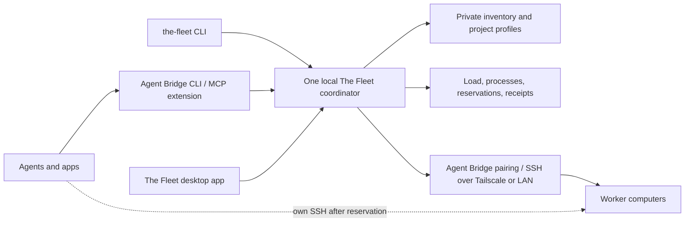

# The Fleet


One shared point of contact for your worker computers. Apps and agents ask The
Fleet which worker is available, see current load and work, and reserve capacity.
They can then submit a managed job or use their own SSH connection.

The Fleet is a generic TypeScript/Node package with an Agent Bridge extension.
It contains no personal machine inventory, addresses, credentials or project
registrations. Each installation supplies those in private configuration.
Former name: Fleet Runner. The `fleet-runner` command is a compatibility alias.

## Get started

[Download the macOS app](https://github.com/EthanSK/the-fleet/releases/latest/download/The-Fleet-macOS-arm64.zip) · [Source and releases](https://github.com/EthanSK/the-fleet/releases)

The download is for Apple silicon Macs running macOS 14 or newer. Install the
shared command first, then unzip the app and move it to Applications:

```sh
git clone https://github.com/EthanSK/the-fleet.git
cd the-fleet
npm ci
npm link
the-fleet --version
```

The app and command use one local service. Set up your own worker pairings and
private inventory using the guide below; no personal machines or keys are
included. A worker needs the tools its jobs use, not a running copy of this app.

The app is ad-hoc signed and is not notarized. macOS may block a downloaded
copy; review [Apple's guidance for opening trusted apps](https://support.apple.com/en-gb/102445),
or build from source using the Desktop app section below. No App Store or
package-manager release is provided. The existing [No-Sale license](LICENSE)
permits internal use and free redistribution; selling the covered software
requires a separate license.

## Architecture



- The local service listens on a user-private Unix socket. All normal CLI and
  Agent Bridge requests reach that same instance. A permanent kernel file lock
  prevents simultaneous startup, including launchd and concurrent callers.
- Worker observations include their timestamp, load averages, CPU count, memory,
  disk, detected heavy processes, remote job lock and recent jobs. Reservations
  identify the owning app and work. Detection of unrelated work is best effort;
  arbitrary SSH activity cannot be fully inferred from a process name.
- Managed jobs reuse the existing remote supervisor: selected source transfer,
  a per-worker kernel lock, deadlines, cancellation, verified outputs and receipts.
  There is no permanent worker daemon. A test failure never triggers a replay on
  another worker. Offline/busy refusals can advance to another registered worker.
- External SSH reservations coordinate cooperating clients. Renew while working,
  then stop your work and release. Expiry marks ownership uncertain; it does not
  claim that a process stopped. After a coordinator crash, `recover-reservations`
  clears only managed reservations with freshly verified idle workers. External
  reservations still require their token and an explicit verified release.
- This is coordination for trusted local apps, not an executable-code sandbox.
  Your OS user can run arbitrary SSH and bypass it. Unreserved work is reported
  where observable but cannot be forced through this service.

## Install and pair workers

Requires Node 22.18+, Python 3 and SSH on the controller. Workers need Bash,
Python 3, tar and the tools their jobs use. The supervisor supports macOS and
Linux; each actual worker/toolchain still needs qualification.

```sh
npm ci
npm link
the-fleet --version
agent-bridge pair                  # follow Agent Bridge's pairing prompts
the-fleet machine add worker --bridge-target MyWorker --default
the-fleet state --fresh
the-fleet doctor --machine worker
```

Agent Bridge owns host/user/SSH-key paths in its pairing config. The Fleet's
private `~/.the-fleet/machines.json` owns worker limits, aliases, tool PATH and
remote scratch root. One physical worker must use one scratch root. Never copy
private keys into a repository. SSH remembers new host identities and refuses
changed host keys; verify a new worker's fingerprint through a trusted channel.

For machines on different networks, install and sign in to Tailscale on each.
Set the pairing's `internet_host` to the stable tailnet IP or DNS name. This route
takes precedence over the LAN route. Enable the worker's normal SSH service and
pair it using an authorized SSH key. For a dedicated unattended worker, its owner
can disable device-key expiry in Tailscale's admin console; this is separate from
SSH-key authorization. Do not store Tailscale login tokens in project files. See the official [key-expiry guide](https://tailscale.com/kb/1028/key-expiry) and [MagicDNS guide](https://tailscale.com/docs/features/magicdns).

The CLI auto-starts the local service. On macOS, `the-fleet service install`
writes an optional per-user LaunchAgent and prints its load command. It starts
at login and restarts after failure; it does not require administrator access.
On Linux, a user service can run:
`python3 /path/to/bin/service-lock.py /path/to/node /path/to/bin/the-fleet.js service serve`.
Set `THE_FLEET_HOME` consistently for all clients and the service to share one
installation. Legacy `FLEET_RUNNER_HOME` is also accepted. Different explicit
homes are independent installations, not a global scheduler.

`the-fleet <command> --help` (or `-h`) displays usage without starting or
contacting the service, reserving a worker or executing the command. Help after
the `--` separator belongs to the profile command and is passed through normally.

## Agent Bridge extension

Agent Bridge's `extensions/the-fleet` documents installation. Its CLI delegates
`agent-bridge fleet ...` to this package. Its MCP server exposes
`bridge_fleet_state` and `bridge_fleet`; the latter submits jobs, polls operations,
cancels jobs and manages reservations. Set `THE_FLEET_BIN` in Agent Bridge's
environment if `the-fleet` is not on its PATH. No second runner is embedded in
Agent Bridge. Existing MCP clients need a reconnect after installing new tools.

## A request each time, or optional saved profiles

A recipe is simply saved job details: which source files, command, preparation,
limits and success evidence to use again. It is optional, and it is not a cached
answer. Every run reads current source, checks the worker and produces a receipt.
Saving a profile avoids repeatedly spelling out a complicated test command.

For a one-time request, write JSON (or pipe it on stdin):

```json
{
  "project": "example",
  "source": "/path/to/current/worktree",
  "files": ["package.json", "package-lock.json", "src/**", "test/**"],
  "prepare": [["npm", "ci", "--no-audit", "--no-fund"]],
  "command": ["npm", "test"],
  "timeoutMinutes": 10,
  "requires": { "tools": ["node", "npm"] },
  "success": { "minTestCount": { "pattern": "# tests (\\d+)", "min": 1 } }
}
```

```sh
the-fleet submit request.json
the-fleet submit request.json --machine first
the-fleet submit request.json --machines first,second
the-fleet submit request.json --dry-run --machine first
the-fleet register /path/to/project/the-fleet.json --source /path/to/project
the-fleet run example test
the-fleet run example test --source /path/to/another/worktree
```

One-time requests are not registered. Saved manifests live wherever their owner
chooses; registrations store a pointer and source root in the private state
directory. Unpinned runs try registered workers in order, default worker first.
Saved runs and one-time submit requests share that same ordering rule.
A manifest's explicit `defaultMachine` preserves a project-specific worker rule.
Use `--machine worker` to pin a saved run or one-time submit to one worker.
Use `--machines first,second` for an ordered list of candidates. Submit rejects
unknown, repeated or conflicting worker options instead of ignoring them.
No automatic local fallback runs tests on your laptop.
Physical hardware, real microphone/camera and live desktop tests still run on
the computer that owns those resources.

For the complete existing manifest contract, use
`{"source":"/path/to/worktree","manifest":{...},"profile":"test"}` instead of
the shorthand fields. `manifest` is the same schema-version-1 object used in
`the-fleet.json`; all exclusions, byte limits, extra inputs, environment, finalizer,
temporary-folder and output settings go through the same validator. No project
registration is created. Keep `manifest.id` stable to reuse that project's rsync
source copy; a cache name alone does not identify a project.

`submit request.json --dry-run [--machine worker]` returns the existing source
plan, including `source.digest`, without contacting a worker or starting a job.
Use the same request and selected worker when comparing source after a build.
It reads current on-disk files, so edited inputs change the digest. Worker-specific
settings belong in private machine `env`; `requires.machineEnv` names settings a
worker must supply. Machine values override generic profile values.

## Shared controller setup

Register a project's recipe once with `the-fleet register` to enable it. Apps can
then resolve the current checkout through the same coordinator:

```sh
the-fleet project resolve --source "$PWD" --manifest "$PWD/the-fleet.json"
```

The JSON result is `{ "project": null }` for an unregistered workspace. A match
contains `id`, the current `sourceRoot`, and the current `manifestPath`. Linked
Git worktrees match by their common repository and project subdirectory. A
missing or mismatched recipe is an error; resolution never substitutes the
registered main checkout. Submit the current recipe and source with the normal
`the-fleet submit` command, preserving the app's per-run arguments/environment.

`GET /v1/config` exposes the effective `paths.runsDirectory` and a separate
`controller` object with `revision` and the optional `runsDirectory` override.
`PUT /v1/config/controller` accepts `{ "revision": "...", "runsDirectory":
"/existing/results.noindex" }`; use `null` to restore the default. The directory
must already exist. The private setting is stored in `settings.json`, separately
from the worker inventory. New jobs read it without restarting the service;
already-started jobs keep their destination. An explicit per-request destination
wins, followed by an environment override, the controller setting, then
`runs.noindex` under the state folder. An unavailable configured drive refuses
writes instead of quietly filling another disk; settings remain accessible.

## Shared job capacity

Ordinary managed jobs share a worker, up to private worker setting
`limits.maxConcurrentJobs` (default 2, range 1–8). These are **job slots**,
not estimates of a job's future CPU/RAM use. Fresh disk, available memory and
kernel-pressure checks still apply; CPU load is reported for the caller's
judgment, so some CPU overcommit is possible. Raw swap is display-only.

Set a profile's `exclusive: true` for work which needs the worker alone.
Declare worker-local conflicts in `resources`, for example `["port:4200"]`.
GUI profiles automatically claim `desktop`. Each job still gets independent
source, temporary files, cancellation, finalizers, outputs and receipts.
Ordinary state includes every `assignments` entry and `capacity` with the
slot limit, usage, free slots and drain state. Named conflicts can refuse a
particular job even when a slot is free.

A named cache remains serialized unless its owner explicitly sets
`cache.concurrent: true` after checking its tools support simultaneous use.
Concurrent users can share the same cache name. Mutable rsync source sync,
verification and materialization are serialized per cache/project; execution
uses an independent copy. Cache usage stays protected through uploads and job
children. Post-job retention can evict an over-limit cache only after its last
user leaves; the limit is a retention cap, not a hard concurrent disk quota.
Use immutable/versioned executable paths or setup-only locks when two versions
would otherwise replace each other's binaries. Do not opt in an unsafe tool.

Existing external reservations remain exclusive. An external client can opt
into slots through `reserve --shared --resources port:4200` (or API
`claim: {mode:"shared",resources:["port:4200"]}`). Keep the claim while using
SSH. For a shared external release while neighbours remain busy, explicitly
attest your own work stopped with `release --work-stopped`; the token is still
required. Expiry/restart retains the claim's capacity and conflicts until
verified release; neither proves an arbitrary SSH command ended.

For maintenance, `reserve --drain` (API claim mode `drain`) stops new admission
without cancelling existing jobs. It returns `ready:false` and no connection.
Call `activate --id ... --token ...` after jobs finish; a fresh idle check and
no neighbouring claims are required before it becomes exclusive and returns
the connection. Keep renewing it. Releasing an unactivated drain cancels the
barrier. Legacy exclusive supervisors and maintenance share the same permanent
kernel admission inode with the shared readers, so they cannot overlap.

`cancel --job JOB --machine WORKER` and `lock clear --job JOB --machine WORKER`
target one shared job. Unscoped cancellation refuses to guess among shared
jobs. Stale recovery needs exclusive admission and never kills a neighbour.
`status` lists each shared job and its exact recovery target. The native app's
Work tab lists simultaneous operations; worker cards identify an active shared
job, and Overview uses the coordinator's capacity decision for its available
worker count. No slot editor or multi-assignment worker-detail layout is added.

## Worker inspection and safe cleanup

`state --fresh` remains read-only. It now includes the top 20 processes by resident
memory (RSS), process IDs, parent/group IDs, owner IDs, CPU use and elapsed time.
Only executable names are collected, never command arguments. `memoryAssessment`
flags high resident use for investigation: at least 512 MiB or 10% of worker RAM,
whichever is larger. A snapshot does not establish a leak; shared resident pages
can be counted in several processes. Raw swap remains display-only.

`the-fleet maintain [--machine worker]` inspects and automatically reclaims only
an exact, marked stale Fleet job. The same bounded foreground check runs before
managed-job admission and external reservation requests. It preserves every
existing reservation, including expired/unverified external ownership and active
managed work. Read-only discovery never cleans anything; no background watcher,
retry queue, arbitrary app termination or service restart is installed.

Cleanup rechecks the observed job under the existing permanent kernel admission
guard. Its supervisor, job group, upload and finalizer must be gone. A missing
marker, changed job, symlink or unknown owner is retained. Existing finalizers and
bounded output capture run before scratch deletion, preserving failed evidence
and pending outputs. An uncertain cleanup keeps coordinator ownership for recovery.
Interrupted managed reservations still use `recover-reservations`; external work
still requires its token and explicit release. The latest maintenance result is
included in worker state with its observation time.

## Discovery and your own SSH

```sh
the-fleet state --fresh
the-fleet reserve --owner my-agent --label "Focused tests" --machines worker
the-fleet renew --id RESERVATION_ID --token RESERVATION_TOKEN
the-fleet release --id RESERVATION_ID --token RESERVATION_TOKEN
```

Reserve returns connection information (including an SSH key path, never its
contents), current health, a reservation ID and a private token. Keep the token
out of shared logs. The worker remains reserved until release is verified.
Reservations are private mode-0600 state. Their stored token is hashed.

## Local API

HTTP runs over `~/.the-fleet/service.sock` (mode 0600), not an open TCP port.
`the-fleet rpc METHOD /v1/path [body.json|-]` uses the same API for integrations.

| Route | Purpose |
| --- | --- |
| GET /v1/health | Service identity and process ID |
| GET /v1/state?fresh=1 | Worker observations and ownership |
| POST /v1/submit | `{cwd, owner, request, machines?}` for one-time details |
| POST /v1/submit/plan | `{cwd, request, machine?}` for a one-time source preview |
| POST /v1/maintenance | `{machine?}` for foreground inspection and guarded stale-job cleanup |
| POST /v1/command | `{cwd, owner, argv}` for existing CLI operations |
| GET /v1/operations/ID?offset=N | Poll output/result; also keeps job alive |
| POST /v1/operations/ID/cancel | Idempotent cancellation; optional `{forceDisconnect: true}` explicitly disconnects SSH |
| POST /v1/reservations | `{owner, label, machines?, ttlSeconds?, claim?}` |
| POST /v1/activate | `{id, token}`: activate a drained worker after fresh idle proof |
| POST /v1/renew or /v1/release | `{id, token, ttlSeconds?}` |
| POST /v1/recover?machine=ID | Verify and clear interrupted managed ownership for one worker; omit the query for the whole fleet |
| GET /v1/config | Worker settings, controller revision and effective results folder; environment names only |
| PUT /v1/config/controller | `{revision, runsDirectory: absoluteNoindexPath \| null}` shared results-folder default |
| POST /v1/projects/resolve | `{source, manifestPath?}` resolves current-worktree registration or returns `project: null` |
| GET /v1/pairings | Agent Bridge pairings with route kind; key paths reported as present, never shown |
| POST /v1/pairings/check | `{target, remoteRoot?, id?}` read-only check: reachability, identity, `sameAs`, `dispatchingComputer` |
| POST /v1/machines | `{revision, id, target, description?, aliases?, remoteRoot?, pathPrepend?, env?, limits?, makeDefault?}` |
| PUT /v1/machines/ID | `{revision, ...changed fields}`; `env` is `{NAME: {keep: true} \| {value}}` |
| DELETE /v1/machines/ID?revision=R | Remove the entry only; pairing, remote folder and runs stay |
| GET /v1/projects | Registered projects and profiles from their live manifests |
| POST /v1/projects/ID/plan | `{profile, machine?}` what a run would send; contacts no worker |
| POST /v1/projects/ID/run | `{profile, machine? \| machines?, owner?, detached?}` runs a saved profile |
| GET /v1/operations | Retained operations with label, owner, worker and job IDs |
| GET /v1/runs?limit=N&project=P | Finished runs from receipts, across run stores |
| GET /v1/runs/JOB?tail=BYTES | One receipt with bounded stdout/stderr tails |

Submit returns an operation ID promptly. Poll within 75 seconds; an abandoned
managed operation is cancelled, with remote cleanup governed by the supervisor.
CLI polling is automatic. Output retained in the service is bounded; full job
logs/receipts live in the private run store. `THE_FLEET_RUNS_DIRECTORY` (legacy
`FLEET_RUNNER_RUNS_DIRECTORY`) can select an existing absolute `.noindex` store.

`detached: true` (on submit, command or profile run) opts out of abandonment:
the operation is never cancelled for missing polls and still ends at its own
profile deadline or an explicit cancel. Add `observe=1` when polling an
operation you only watch; it reads output without acting as its heartbeat, so
abandoned work is still cancelled. The coordinator records where each managed
receipt was written in a bounded `run-index.json`, so run history covers every
run store; a pruned or unmounted receipt is listed as unavailable.

Worker-settings writes re-validate the whole registry with the CLI's parser and
need the `revision` they were based on; a stale revision gets HTTP 409 with
`code: "revision-conflict"`. Changing a worker's pairing or remote folder is
refused while it has a reservation or coordinated run; moving the remote folder
also needs the current folder's job lock verified free. A run admitted with
superseded route or folder settings is refused before it starts. Errors carry a
`code` (`invalid`, `busy`, `not-found`, `revision-conflict`, `unknown-route`).

See [managed execution](docs/execution.md) for source selection, optional rsync,
artifacts, cache limits, finalizers and recovery. See `the-fleet --help` for the
complete CLI. Internal `fleet-runner` protocol/path markers remain stable for
existing workers; they are not a second implementation.

Returned regular-file artifacts retain their tar/PAX modification times, to the
precision supported by Node and the destination filesystem. This also applies
to recovered artifacts. Paths, sizes and content hashes are still checked;
malformed or unrepresentable timestamps are rejected. Directory and symlink
timestamps are not restored.

## Large temporary output archives

Project `the-fleet.json` files describe jobs. Personal worker locations and devices
belong only in the private machine registry. A worker can opt into large-archive
scratch through its `largeScratch` setting, for example:

```json
{
  "mountPoint": "/Volumes/External",
  "volumeUuid": "00000000-0000-4000-8000-000000000001",
  "directory": "AgentScratch.noindex/the-fleet",
  "minFileMiB": 64,
  "minFreeGiB": 8
}
```

Replace the example UUID with the actual volume UUID. On macOS, inspect
`diskutil info -plist /Volumes/External`; on Linux the configured UUID must
resolve through `/dev/disk/by-uuid`. The mount must be a real non-root mount,
and the dedicated relative directory must include a `.noindex` component.
An existing empty root can be provisioned in advance. Unmarked personal
contents, symlink paths, wrong identities, read-only volumes and insufficient
free space are refused; the runner never creates a missing mount point.

Set this object through the existing revision-checked `PUT /v1/machines/ID`
API (along with its current `revision`); `largeScratch: null` disables it.
Unrelated settings edits retain it. Changing the destination requires that
worker to be unreserved. Keep real drive names and UUIDs out of project recipes.

The automatic consumer is the worker's output-transfer `artifacts.tar.part`
and `artifacts.tar`. When the combined logical size of declared outputs reaches
`minFileMiB` (default64), their archive is written into a unique owned directory
on the verified volume. Space for that archive plus `minFreeGiB` (default8)
must remain available. This is a space check, not a filesystem quota.

Small output archives, source, dependencies, caches, ordinary `TMPDIR` and Docker
keep their existing locations. This setting leaves hot job/cache paths unchanged. Upload tar is streamed directly and has
no temporary worker archive to relocate. This setting does not redirect all
temporary files or change where a project's build tools write their outputs.

The archive reader/writer and cleanup use pinned file descriptors and per-job
ownership. Hash verification, limits, ACK and recovery stay in force. Verified
return cleans the job's external archive directory on success, failure and
cancellation. Unacknowledged results remain recoverable; a changed/missing drive
or uncertain ownership retains output and the job's ownership for inspection.
The root ownership marker and allocation guard remain for later jobs.

## Disk-space notifications

The shared coordinator sends one controller-local notification when an actual
operation encounters an internal low-disk refusal or an external archive-space
refusal. A skipped worker still counts when another worker succeeds. Status
polling, ordinary busy slots, memory refusals and normal size-based USB use stay
quiet. The existing admission, archive selection and cleanup rules do not change.

The production service reuses `agent-bridge notify --local` from its PATH, with
its existing native notification support. Agent Bridge is optional; an absent
or failed sender is logged without changing the operation result or retrying the
notification. Other service embedders can supply `ApiOptions.notifyDiskSpace`;
isolated API fixtures default to no notification sender. No new monitor or
background polling is installed.

## Desktop app

`desktop/` is a native SwiftUI app named The Fleet that lives in the Dock. It
shows each worker as a faceplate with its device, status, one LED per CPU core
lit to the current load, memory, disk and current owner; drills into health,
recent jobs, reservations and connection; adds workers from Agent Bridge
pairings, edits their settings and removes them; and runs saved profiles, shows
live and finished work with receipts and logs, and cancels coordinated runs.

It is only a client of the one local coordinator over its socket. It never runs
jobs, stores worker settings or copies connection details. When nothing is
listening it can start the service through the installed CLI's own kernel-locked
auto-start, detached from the app. Quitting the app leaves the service and every
job running; runs it starts are `detached`. It finds the service folder and CLI
through the login service (`the-fleet service install`), `THE_FLEET_HOME`, an
installed `the-fleet` command, or its Settings window.

```sh
desktop/Scripts/package-app.sh          # writes desktop/build.noindex/The Fleet.app
```

The script compiles with SwiftPM, exports the transparent ship artwork from
`desktop/Resources/FleetShips.png` to every macOS icon size, assembles and
signs the bundle (ad-hoc unless `CODE_SIGN_IDENTITY` is set) and installs
nothing. `THE_FLEET_APP_BUILD_DIR` and `THE_FLEET_SWIFT_SCRATCH_PATH` move its
output. Building needs Xcode 16 or newer (Swift 6 toolchain) on macOS 14 or
newer. At runtime the app needs The Fleet installed on the same Mac (Node 22.18+,
Python 3, SSH); copy the app to /Applications yourself. Packaging also creates
`The Fleet.app.zip`, preserving the bundle and executable permissions. The
`desktop-package` profile returns that ZIP through The Fleet with its hash
verified, so a worker build can be installed on the coordinating Mac.

## Development

```sh
npm ci
npm run typecheck
the-fleet register the-fleet.json --source "$PWD"
the-fleet run fleet-runner test
the-fleet run fleet-runner desktop            # Swift tests, including headless view rendering
the-fleet run fleet-runner desktop-package    # packages and signs the app on a worker
```

The core test suite uses disposable worker fixtures. Service tests cover
concurrent clients, alias contention, expiry, restart, API validation and kernel
singleton startup. Qualify lifecycle changes on a real worker too. Test fixtures
do not establish physical hardware or live desktop acceptance.

First-party code uses No-Sale Terms 1.0; see LICENSE and LICENSING.md. Source and the macOS download are published in this repository and its Releases.

## Moving an existing state folder

New installations use `~/.the-fleet`. Existing `~/.fleet-runner` state keeps
working until its owner explicitly migrates it. Both CLI names, the Agent
Bridge extension and the desktop app still contact one coordinator. Custom
`THE_FLEET_HOME` (and legacy `FLEET_RUNNER_HOME`) folders keep their explicit
locations. Remote worker scratch names and protocol identifiers do not change.

Finish running jobs. On macOS, unload the login service if it is loaded:

```sh
launchctl bootout gui/"$(id -u)"/org.the-fleet.service
```

Then use:

```sh
the-fleet migrate-home --dry-run
the-fleet service stop
the-fleet migrate-home
```

The dry run makes no changes; it does not promise the service is stopped. The
actual migration refuses a live coordinator and locks out simultaneous startup.
It atomically renames the existing folder on the same filesystem; it does not
copy, merge or delete results. Worker settings, reservation ownership and
immutable receipt bytes stay unchanged. Mutable history and registration
pointers inside the old folder move with it; external result folders stay put.
The owned login-service plist is updated when present. Reload that service after
migration so launchd uses its new log paths, then open the updated desktop app.

If interrupted, run `the-fleet migrate-home` again. An incomplete migration
refuses coordinator startup. A completed migration record redirects clients
that still explicitly name the old default home, without creating another
writable state tree or a compatibility symlink. Two independent existing state
folders are an error requiring the owner to resolve them. No reservations are
released and no worker processes are stopped by migration.
